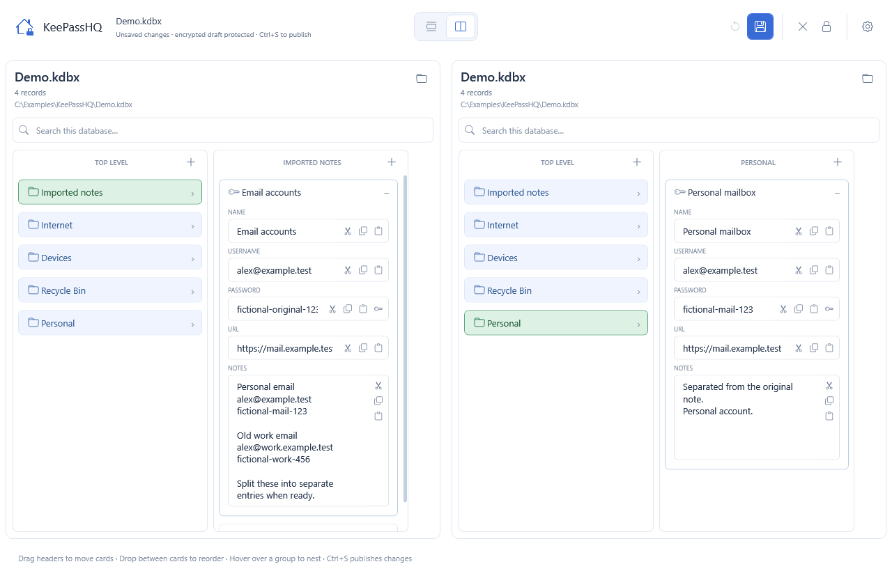

<p align="center"></p>

# KeePassHQ

A portable Windows workspace for browsing and organizing KeePass databases. Expand cards, clean up notes, and move entries between nested groups without wrestling with a compact tree.

**Version 1.2 · Windows x64 · .NET Framework 4.8+ · GPL-2.0-or-later**

[Source](https://github.com/w3medialabs/keepasshq) · [Releases](https://github.com/w3medialabs/keepasshq/releases) · [Issues](https://github.com/w3medialabs/keepasshq/issues) · [Private security reports](https://github.com/w3medialabs/keepasshq/security/advisories/new)

## KeePass and KeePassHQ

[KeePass](https://keepass.info/) is a free, open-source password manager. KeePass 2 stores login details and notes in groups inside an encrypted `.kdbx` database file that you control.

Unlocking decrypts the database using its master key: usually a master password, optionally combined with a key file or Windows-account-protected factor. Every configured factor is required to open it again. Saving writes an encrypted database back to disk; no hosted password-manager account is required. See KeePass's [master-key guide](https://keepass.info/help/base/keys.html).

KeePassHQ is an independent, portable Windows app for working with these databases. It embeds the pinned KeePass 2.62 library for database encryption and adds searchable card browsing, live editing, nested-group organization, drag-and-drop ordering, and save/conflict recovery. Viewer has one browser; Organizer has two for the same or separate databases, including copy/move between them. It works offline without an installed copy of KeePass and is not an official KeePass release.



## Get started

Download a published portable archive from [GitHub Releases](https://github.com/w3medialabs/keepasshq/releases), when available, and verify its published SHA-256. Until a binary release is published, [build from source](docs/BUILD.md). The executable is unsigned. Windows x64 with .NET Framework 4.8 or later is required; Windows on ARM and other operating systems are not supported targets.

1. Extract the portable release and run `KeePassHQ.exe`. No installer or installed copy of KeePass is required.
2. Browse to an existing `.kdbx`, supply its key factors, and unlock. Or choose **Create new database** to create an empty database with a new name and key.
3. Use **Viewer** for one browser or **Organizer** for two equal browsers. Initially both browse the same database independently.
4. Click a group to open its children one column to the right. Click an entry to expand its editable fields.
5. Drag a card onto a group to nest it, or into an expanding gap to set its position. Save with **Ctrl+S** when the edits are ready.

Use a disposable copy first. Passwords are deliberately visible while entries are expanded. The application has no network client, account, telemetry, update checker, or cloud API; a sync provider can still synchronize the encrypted files you choose.

## Focused features

- Identical card browsers in both modes; independent navigation, shared live edits when browsing the same database.
- Independent search bars in both browsers, with searchable names/usernames/URLs/notes/group paths and links back to each result's folder.
- Five editable fields: name, username, password, URL, and selectable multiline notes. Integrated cut/copy/paste actions.
- Create groups and entries at any level, rename groups, reorder mixed cards, and move in either direction. Active groups are green.
- Open or create a different database from either pane's **Database** menu. Keys, models, drafts, saves, and file gates remain separate.
- Cross-database **Save & copy** or **Save & move**. Moves save and verify the destination before removing the source; an interruption may leave a duplicate.
- Explicit saves, private encrypted draft checkpoints, save reminders, inactivity locking, safe database closing, and recovery copies.
- SHA-256 change detection and three-way conflict review before replacing a changed database. Encrypted backups and post-replacement checks preserve late writers.
- Password generator with length/category rules and exactly **Cancel**, **Copy**, and **Use**.
- Locally bundled Help/F1, plus privacy-conscious manual reporting guidance and explicit blank-template/link copying.
- KeePass 2.62 handles KDBX encryption and rich metadata. Hidden fields, history, and attachments are retained without reducing entries to the visible fields.

## Documentation

| Document | Contents |
| --- | --- |
| [Feature list](FEATURES.md) | Supported behavior and deliberate limits |
| [User guide](docs/USER-GUIDE.md) | Navigation, editing, two databases, saving, drafts and recovery |
| [In-app Help guide](docs/HELP.md) | Offline topics bundled into the executable |
| [Reporting privacy](docs/REPORTING.md) | Manual GitHub reports, permitted template data and exclusions |
| [Issues and labels](docs/ISSUES.md) | Report templates, maintainer triage and reproducible label setup |
| [Build and tests](docs/BUILD.md) | Offline build, diagnostics, source layout and CI |
| [Security policy](SECURITY.md) | Threat boundaries and private reporting |
| [Development audit](docs/AUDIT.md) | Findings, corrections, tests and remaining limits |
| [Final adversarial review](docs/FINAL-AUDIT.md) | KeePass documentation comparison, reproduced preservation/privacy gaps and fixes |
| [Adversarial follow-up](docs/ADVERSARIAL-AUDIT.md) | Reproduced edge cases, fixes and regression evidence |
| [UI completeness follow-up](docs/UI-COMPLETENESS.md) | Keyboard/reveal cleanup, styled-control behavior and local deployment |
| [Architecture](docs/ARCHITECTURE.md) | Sessions, storage, merge and transfer protocol |
| [Design choices](docs/THEORY.md) | Browser model, private edits, preservation and narrow runtime |
| [Contributing](CONTRIBUTING.md) | Small changes, synthetic fixtures and review expectations |
| [Release checklist](docs/RELEASING.md) | Publishing a public repository and reproducible checks |
| [Changelog](CHANGELOG.md) | Version history |
| [Third-party notices](THIRD-PARTY.md) | KeePass, Bootstrap Icons and source provenance |

## Build and contribute

```powershell
git clone https://github.com/w3medialabs/keepasshq.git
cd keepasshq
.\build.ps1 -OutputDirectory .\bin
powershell -NoProfile -File .\validate.ps1 -Render
```

Builds use the bundled, hash-pinned KeePass 2.62 dependency without package restore. Validation checks source inventory, documentation links and provenance, builds release and diagnostics, checks release boundaries, embedded Help and dependency integrity, runs 430 synthetic assertions and two dependency-shadow startup checks, and renders nineteen fictional previews. To create a local portable deployment with a fictional demo, run `powershell -NoProfile -File .\package.ps1 -Demo` from a clean committed checkout; see [release instructions](docs/RELEASING.md). See [Contributing](CONTRIBUTING.md) before opening a [pull request](https://github.com/w3medialabs/keepasshq/pulls).

This is an independent application using KeePass technology, not an official KeePass release. The house-lock mark is from [Bootstrap Icons](https://icons.getbootstrap.com/icons/house-lock/), used under MIT. KeePassHQ and its combined distribution are GPL-2.0-or-later; see [LICENSE](LICENSE).
